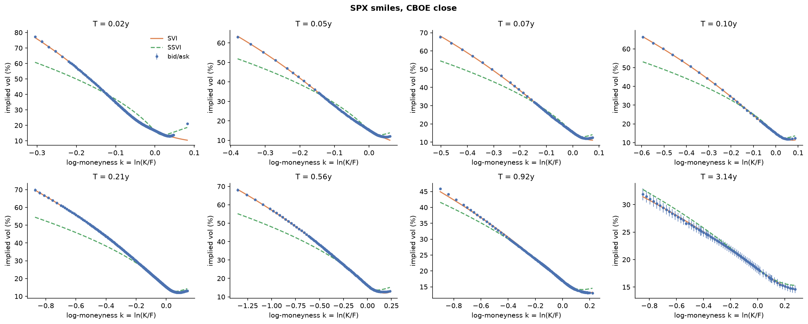

# volsurface


Build an arbitrage-free implied volatility surface from raw option quotes, then
extract Dupire local volatility for pricing path-dependent products.

**Pipeline:** raw bid/ask quotes → cleaning → implied forwards and discount factors from
put-call parity → OTM implied vols → per-expiry SVI smiles → global SSVI and eSSVI surfaces →
static-arbitrage checks → Dupire local vol.


## Quickstart

```bash
pip install -e ".[dev]"
pytest
python examples/synthetic_demo.py        # offline, against a known true surface
python examples/snapshot.py              # save today's CBOE ^SPX / ^NDX close to data/ (any time)
python examples/real_data_study.py       # fit every saved snapshot (M3)
pip install -e ".[pricer]"
python examples/autocallable_skew.py     # skew vs flat vol on a worst-of autocallable (M5)
```

```python
from volsurface import fit_surface, fit_errors
from volsurface.data import load_cboe_chain

quotes, spot, as_of = load_cboe_chain("^SPX")   # or load_yfinance_chain (pip install -e ".[data]")
fit = fit_surface(quotes, spot, max_rel_spread=0.3)
print(fit.ssvi_params, fit.ssvi_arbitrage.summary())
print(fit_errors(fit))
fit.ssvi_surface.implied_vol(K=0.9 * spot, T=1.0)
fit.ssvi_surface.local_vol(K=0.9 * spot, T=1.0)
```

## Method

**Forwards from the market, not from assumptions.** For each expiry, put-call parity
C − P = DF·(F − K) is linear in strike, so a regression on near-the-money strikes gives
the discount factor (−slope) and forward (intercept/DF). Dividend and funding assumptions
are therefore implied by the options themselves.

**OTM quotes only.** Out-of-the-money options are the most liquid, and for American-style
options they carry the least early-exercise premium. Implied vols are computed for bid,
mid, and ask so fit quality can be judged against the spread.

**SVI per expiry** (Gatheral 2004): w(k) = a + b(ρ(k − m) + √((k − m)² + σ²)), where w is total
implied variance and k = ln(K/F). The fit is vega-weighted, multi-start, and penalises
negative variance and violations of Roger Lee's wing bound b(1 + |ρ|) ≤ 2.

**SSVI surface** (Gatheral & Jacquier 2014) with power-law curvature
φ(θ) = η / (θ^γ (1 + θ)^(1−γ)). The ATM total-variance term structure θ(T) is taken from the
SVI slices, forced to be non-decreasing, and interpolated in T with a monotone cubic (PCHIP),
so it is continuously differentiable and the local vol has no jumps at the expiries.
η is reparameterised as η = s·2/(1 + |ρ|), s ∈ (0, 1], so every candidate satisfies the
no-arbitrage bound η(1 + |ρ|) ≤ 2, γ ≤ ½.
The fitted surface is free of static arbitrage by construction.

**eSSVI** (Hendriks & Martini 2019) lets the skew vary with maturity:
ρ(θ) = ρ₀ + (ρ₁ − ρ₀)·√min(θ/θ_ref, 1). Every slice stays butterfly-free through
η = s·2/(1 + max(|ρ₀|, |ρ₁|)). Calendar arbitrage is no longer excluded by construction, so a
decrease of w in θ is penalised during the fit and reported by the diagnostics. The fit starts
from the SSVI solution, so its total weighted error is never worse than SSVI's.

**Arbitrage diagnostics.** Butterfly arbitrage via Gatheral's density function g(k) ≥ 0 on
each slice; calendar arbitrage via w(k, T) non-decreasing in T at fixed k.

**Dupire local volatility** from total variance:

σ²_loc = ∂_T w / [1 − (k/w)∂_k w + ¼(−¼ − 1/w + k²/w²)(∂_k w)² + ½ ∂²_k w]

computed by finite differences on the fitted surface, returning NaN wherever the surface
admits arbitrage (negative numerator or denominator).

## Validation

The synthetic chain generator prices options off a known SSVI surface, adds noise and a
bid-ask spread, and rounds to the tick, so every stage can be checked against the truth:

| Check | Result (noisy synthetic chain) |
|---|---|
| SSVI ρ / η / γ (true −0.70 / 1.00 / 0.40) | −0.699 / 1.002 / 0.399 |
| SSVI RMSE | 0.02–0.12 vol points per expiry |
| Model vols inside bid-ask band | 100% |
| Static arbitrage | none (SVI slices, SSVI, eSSVI) |

On a chain whose skew flattens with maturity (true ρ₀ / ρ₁ = −0.85 / −0.45), constant-ρ SSVI
can no longer fit:

| Check | SSVI | eSSVI |
|---|---|---|
| ρ₀ / ρ₁ | −0.484 (single ρ) | −0.837 / −0.447 |
| Mean RMSE | 0.54 vol points | 0.06 vol points |
| Model vols inside bid-ask band | 54% | 100% |
| Static arbitrage | none | none |

Unit tests also cover implied-vol round trips, parity recovery of forwards and discount
factors, SVI and SSVI parameter recovery, detection of Axel Vogt's known butterfly-arbitrage
SVI counterexample, detection of crossed slices (calendar arbitrage), and local vol
equalling implied vol on a flat surface.


## Real data (M3): SPX and NDX, CBOE close of 2026-10-30

| | SPX | NDX |
|---|---|---|
| Quotes → OTM implied vols | 24,550 → 10,132 (47 expiries) | 14,186 → 3,380 (36 expiries) |
| ATM vol 1m / 1y | 14.9% / 17.1% | 24.2% / 23.1% |
| SSVI ρ / η / γ | −0.55 / 1.24 / 0.50 | −0.46 / 1.26 / 0.46 |
| eSSVI ρ₀ → ρ₁ | −0.68 → −0.53 | −0.53 → −0.44 |
| Median RMSE, SVI / SSVI / eSSVI (vol pts) | 0.20 / 2.25 / 2.27 | 0.14 / 0.84 / 0.73 |
| Static arbitrage, SVI slices | 797 calendar violations, butterfly | 2,076 calendar violations, butterfly |
| Static arbitrage, SSVI and eSSVI | none | none |



Findings:

- **Skew flattens with maturity**, as eSSVI was built for: SPX ρ goes from −0.68 at the short
  end to −0.53 at the long end. eSSVI improves NDX by 0.1 vol points, but barely moves SPX.
- **SSVI's binding constraint is the SPX put wing.** Within ±1 standard deviation of the money
  SSVI is within 0.5–0.7 vol points, but beyond −2 standard deviations it is about 7 vol points
  too low at every maturity. The fit sits on the no-arbitrage boundary (η(1+|ρ|) = 1.92 ≈ 2,
  γ = ½): SPX's put skew is steeper than a single power-law SSVI can be while staying
  arbitrage-free. Free SVI slices follow the wing but pay for it with calendar and butterfly
  arbitrage.
- Tracking ρ, η and the ATM term structure over time needs daily snapshots:
  run `examples/snapshot.py` each trading day; `examples/real_data_study.py` then writes
  `data/study.csv` and `docs/study_params.png`.

## Skew and a worst-of autocallable (M5)

`volsurface.montecarlo.simulate_local_vol` simulates correlated paths under Dupire local vol
(daily log-Euler, forwards matched by construction) in the layout
[sppricer](https://github.com/hossainyousuf751/sp-pricer) products take. It reprices the
surface's own vanillas within 4 standard errors, and with `flat_vols` it is GBM on the same
forward curves and random numbers, which agrees with sppricer's GBM engine (100.49 vs 100.51,
± 0.04).

`examples/autocallable_skew.py` prices sppricer's README note (3y quarterly worst-of Phoenix,
8% p.a. memory coupon, autocall at 100% from year 1, European protection) on SPX and NDX with
the eSSVI surfaces above, ρ(SPX, NDX) = 0.9, against flat ATM vol at maturity (18.2% / 23.6%):

| Protection / coupon barrier | Flat ATM vol | Local vol | Skew effect | P(worst < barrier at maturity) flat → LV |
|---|---|---|---|---|
| 60% / 70% | 100.51 | 95.88 | **−4.62 ± 0.06** | 8.6% → 15.3% |
| 70% / 80% | 97.66 | 94.64 | **−3.02 ± 0.05** | 16.7% → 19.8% |
| 50% / 60% | 102.87 | 97.23 | **−5.63 ± 0.07** | 3.4% → 11.4% |

Prices per 100 notional, 200,000 paths, 95% intervals on the paired difference. Flat vol
misses most of the down-and-in put the investor sells: **skew takes 3–6 points off the fair
value, and the deeper the barrier, the larger the error**, because flat ATM vol is furthest
from the market exactly there. Since the eSSVI surface already under-states the SPX put wing,
these are lower bounds on the skew effect.

## Roadmap

- [x] **M1 Pipeline:** cleaning, parity forwards, implied vols, SVI, SSVI, arbitrage checks, Dupire local vol
- [x] **M2 Smooth term structure:** replace piecewise-linear θ(T) with a monotone spline, removing
      the horizontal bands in the local vol at each expiry
- [x] **M3 Real-data study:** CBOE snapshots, study script, SVI vs SSVI vs eSSVI on real
      spreads (above). Ongoing: the time series of ρ, η and ATM term structure fills in as
      daily snapshots accumulate
- [x] **M4 eSSVI:** maturity-dependent ρ(θ) for better fits across the term structure
- [x] **M5 Link to the pricer:** local-vol Monte Carlo feeding
      [sppricer](https://github.com/hossainyousuf751/sp-pricer) products; skew lowers the
      worst-of autocallable by 3–6 points versus flat vol
- [ ] **M6 Put-wing fit:** a surface that fits the SPX put wing without arbitrage (e.g. eSSVI
      with a per-slice φ, or SVI slices with an arbitrage-repair penalty), so the skew effect
      above stops being a lower bound

## Limitations

Yahoo Finance quotes are delayed and sometimes stale; the snapshot is not synchronised
across strikes. Single-stock and ETF options are American, so implied vols from Black-76
carry a small early-exercise bias even on OTM quotes. A single flat discount per expiry
is used rather than a separate OIS curve. CBOE delayed quotes are end-of-day and for
personal use; snapshots stay in the git-ignored `data/` folder.

SSVI and eSSVI under-fit the SPX deep put wing (see M3). The autocallable study assumes a
constant SPX/NDX correlation of 0.9 (no correlation skew), discounts at a flat rate from
the SPX parity curve, and uses European protection only: sppricer's daily and continuous
barrier corrections assume flat vol, so they are not applied to local-vol paths.

## References

- Gatheral, J. (2006). *The Volatility Surface: A Practitioner's Guide.* Wiley.
- Gatheral, J. & Jacquier, A. (2014). Arbitrage-free SVI volatility surfaces. *Quantitative Finance* 14(1).
- Hendriks, S. & Martini, C. (2019). The extended SSVI volatility surface. *Journal of Computational Finance* 22(5).
- Dupire, B. (1994). Pricing with a smile. *Risk* 7(1).
- Lee, R. (2004). The moment formula for implied volatility at extreme strikes. *Mathematical Finance* 14(3).

## License

[MIT](LICENSE). See [CONTRIBUTING.md](CONTRIBUTING.md) to contribute.
