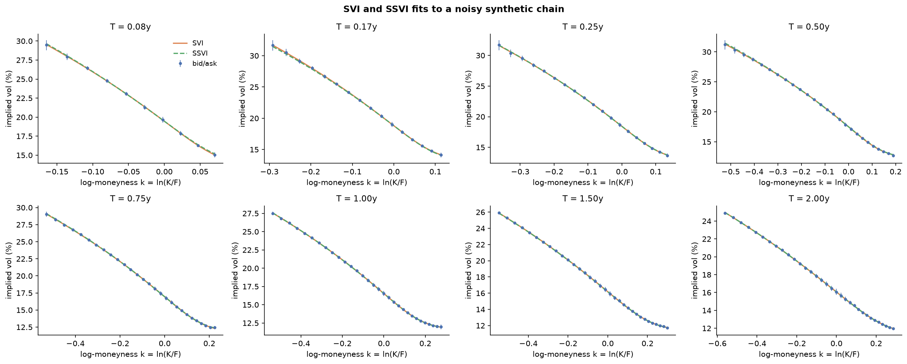
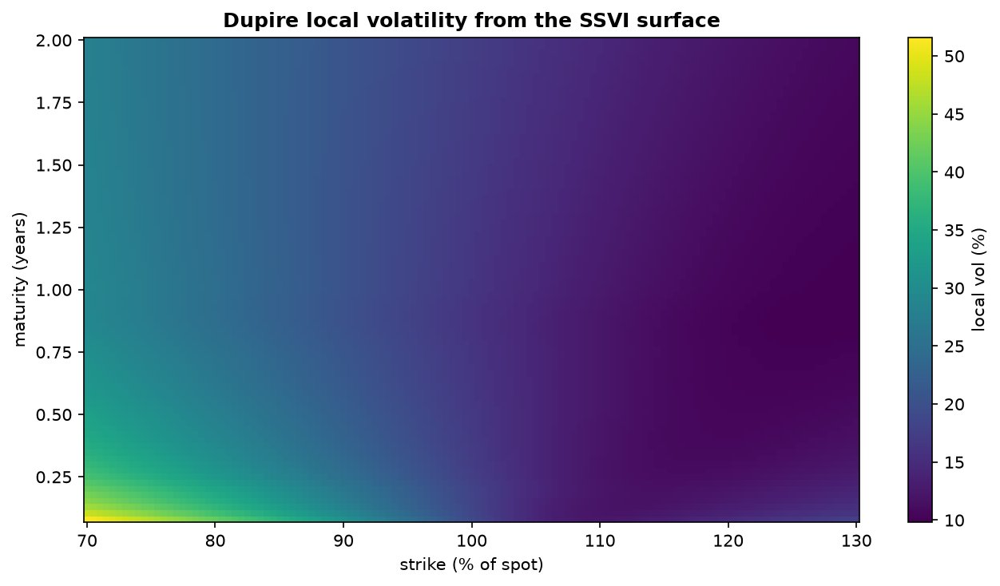

# volsurface


Build an arbitrage-free implied volatility surface from raw option quotes, then
extract Dupire local volatility for pricing path-dependent products.

**Pipeline:** raw bid/ask quotes → cleaning → implied forwards and discount factors from
put-call parity → OTM implied vols → per-expiry SVI smiles → global SSVI and eSSVI surfaces →
static-arbitrage checks → Dupire local vol.



## Quickstart

```bash
pip install -e ".[dev]"
pytest
python examples/synthetic_demo.py        # offline, against a known true surface
pip install -e ".[data]"
python examples/live_fit.py ^SPX         # live Yahoo Finance chain (run in US market hours)
```

```python
from volsurface import fit_surface, fit_errors
from volsurface.data import load_yfinance_chain

quotes, spot = load_yfinance_chain("^SPX")
fit = fit_surface(quotes, spot)
print(fit.ssvi_params, fit.ssvi_arbitrage.summary())
print(fit_errors(fit))
fit.ssvi_surface.implied_vol(K=0.9 * spot, T=1.0)
fit.ssvi_surface.local_vol(K=0.9 * spot, T=1.0)
```

## Method

**Forwards from the market, not from assumptions.** For each expiry, put-call parity
C − P = DF·(F − K) is linear in strike, so a regression on near-the-money strikes gives
the discount factor (−slope) and forward (intercept/DF). Dividend and funding assumptions
are therefore implied by the options themselves.

**OTM quotes only.** Out-of-the-money options are the most liquid, and for American-style
options they carry the least early-exercise premium. Implied vols are computed for bid,
mid, and ask so fit quality can be judged against the spread.

**SVI per expiry** (Gatheral 2004): w(k) = a + b(ρ(k − m) + √((k − m)² + σ²)), where w is total
implied variance and k = ln(K/F). The fit is vega-weighted, multi-start, and penalises
negative variance and violations of Roger Lee's wing bound b(1 + |ρ|) ≤ 2.

**SSVI surface** (Gatheral & Jacquier 2014) with power-law curvature
φ(θ) = η / (θ^γ (1 + θ)^(1−γ)). The ATM total-variance term structure θ(T) is taken from the
SVI slices, forced to be non-decreasing, and interpolated in T with a monotone cubic (PCHIP),
so it is continuously differentiable and the local vol has no jumps at the expiries.
η is reparameterised as η = s·2/(1 + |ρ|), s ∈ (0, 1], so every candidate satisfies the
no-arbitrage bound η(1 + |ρ|) ≤ 2, γ ≤ ½.
The fitted surface is free of static arbitrage by construction.

**eSSVI** (Hendriks & Martini 2019) lets the skew vary with maturity:
ρ(θ) = ρ₀ + (ρ₁ − ρ₀)·√min(θ/θ_ref, 1). Every slice stays butterfly-free through
η = s·2/(1 + max(|ρ₀|, |ρ₁|)). Calendar arbitrage is no longer excluded by construction, so a
decrease of w in θ is penalised during the fit and reported by the diagnostics. The fit starts
from the SSVI solution, so its total weighted error is never worse than SSVI's.

**Arbitrage diagnostics.** Butterfly arbitrage via Gatheral's density function g(k) ≥ 0 on
each slice; calendar arbitrage via w(k, T) non-decreasing in T at fixed k.

**Dupire local volatility** from total variance:

σ²_loc = ∂_T w / [1 − (k/w)∂_k w + ¼(−¼ − 1/w + k²/w²)(∂_k w)² + ½ ∂²_k w]

computed by finite differences on the fitted surface, returning NaN wherever the surface
admits arbitrage (negative numerator or denominator).

## Validation

The synthetic chain generator prices options off a known SSVI surface, adds noise and a
bid-ask spread, and rounds to the tick, so every stage can be checked against the truth:

| Check | Result (noisy synthetic chain) |
|---|---|
| SSVI ρ / η / γ (true −0.70 / 1.00 / 0.40) | −0.699 / 1.002 / 0.399 |
| SSVI RMSE | 0.02–0.12 vol points per expiry |
| Model vols inside bid-ask band | 100% |
| Static arbitrage | none (SVI slices, SSVI, eSSVI) |

On a chain whose skew flattens with maturity (true ρ₀ / ρ₁ = −0.85 / −0.45), constant-ρ SSVI
can no longer fit:

| Check | SSVI | eSSVI |
|---|---|---|
| ρ₀ / ρ₁ | −0.484 (single ρ) | −0.837 / −0.447 |
| Mean RMSE | 0.54 vol points | 0.06 vol points |
| Model vols inside bid-ask band | 54% | 100% |
| Static arbitrage | none | none |

Unit tests also cover implied-vol round trips, parity recovery of forwards and discount
factors, SVI and SSVI parameter recovery, detection of Axel Vogt's known butterfly-arbitrage
SVI counterexample, detection of crossed slices (calendar arbitrage), and local vol
equalling implied vol on a flat surface.



## Roadmap

- [x] **M1 Pipeline:** cleaning, parity forwards, implied vols, SVI, SSVI, arbitrage checks, Dupire local vol
- [x] **M2 Smooth term structure:** replace piecewise-linear θ(T) with a monotone spline, removing
      the horizontal bands in the local vol at each expiry
- [ ] **M3 Real-data study:** daily ^SPX snapshots; track how ρ, η, and ATM term structure move
      with the market; compare SVI and SSVI fit quality on real spreads
- [x] **M4 eSSVI:** maturity-dependent ρ(θ) for better fits across the term structure
- [ ] **M5 Link to the pricer:** local-vol Monte Carlo in
      [sppricer](https://github.com/hossainyousuf751/sp-pricer); quantify how much skew lowers
      the fair value of a worst-of autocallable compared with a flat-vol price

## Limitations

Yahoo Finance quotes are delayed and sometimes stale; the snapshot is not synchronised
across strikes. Single-stock and ETF options are American, so implied vols from Black-76
carry a small early-exercise bias even on OTM quotes. A single flat discount per expiry
is used rather than a separate OIS curve.

## References

- Gatheral, J. (2006). *The Volatility Surface: A Practitioner's Guide.* Wiley.
- Gatheral, J. & Jacquier, A. (2014). Arbitrage-free SVI volatility surfaces. *Quantitative Finance* 14(1).
- Hendriks, S. & Martini, C. (2019). The extended SSVI volatility surface. *Journal of Computational Finance* 22(5).
- Dupire, B. (1994). Pricing with a smile. *Risk* 7(1).
- Lee, R. (2004). The moment formula for implied volatility at extreme strikes. *Mathematical Finance* 14(3).

## License

[MIT](LICENSE). See [CONTRIBUTING.md](CONTRIBUTING.md) to contribute.
